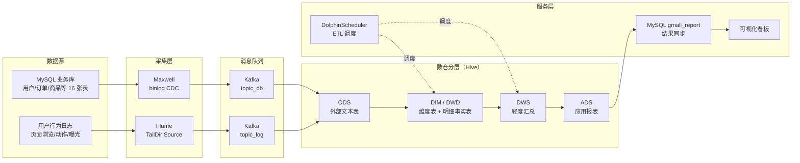

# 电商数据仓库项目（Hadoop 离线数仓）

基于 Hadoop 生态搭建的 **3 节点离线数据仓库**，打通「数据采集 → 分层建模 → 任务调度 → 指标可视化」全链路，产出 GMV、区域销售、商品排行等经营指标。

## 项目成果

| 指标 | 数值 |
|:---|:---|
| GMV 成交总额 | **1,325,297.50 元** |
| 订单量 / 下单用户数 | **187 单 / 135 人** |
| 省份销售 Top1 | 新疆 125,161.30 元 |
| 商品销售 Top1 | 联想拯救者 Y9000P（165,736.00 元） |
| 数仓表数量 | **ODS 16 张 + DIM/DWD/DWS/ADS 20 余张** |
| 处理数据量 | 业务数据 2,651 条 + 行为日志 1,299 条 + CDC 变更 2,429 条 |

## 系统架构



## 技术栈

| 层次 | 组件 | 版本 |
|:---|:---|:---|
| 分布式存储 / 计算 | Hadoop（HDFS + YARN） | 3.3.4 |
| 资源协调 | ZooKeeper | 3.7.1 |
| 消息队列 | Kafka | 3.3.1 |
| 数据仓库 | Hive | 3.1.3 |
| 计算引擎 | Spark on YARN | 3.3.1 |
| 关系型数据库 | MySQL | 5.7.28 |
| CDC 采集 | Maxwell | 1.29.2 |
| 日志采集 | Flume | 1.10.1 |
| 任务调度 | DolphinScheduler | 2.0.5 |
| 数据同步 | DataX | 3.0 |
| 可视化 | ECharts | 5.4.3 |

**集群规模**：3 台虚拟机（hadoop102/103/104），每台 4 核 4G 内存 50G 磁盘

## 数仓分层设计

| 分层 | 定位 | 存储格式 | 示例表 |
|:---|:---|:---|:---|
| **ODS** | 原样保存源数据，可回溯 | 外部表 + TEXTFILE | `ods_order_info_inc`、`ods_user_info_inc` |
| **DIM** | 维度表，支持多维分析 | ORC + Snappy | `dim_user_zip`（拉链表）、`dim_sku_full`、`dim_date` |
| **DWD** | 清洗后的明细事实表 | ORC + Snappy | `dwd_trade_order_detail_inc` |
| **DWS** | 按主题轻度汇总 | ORC + Snappy | `dws_trade_user_order_1d`、`dws_trade_province_order_1d` |
| **ADS** | 面向业务的最终报表 | ORC | `ads_gmv`、`ads_order_by_province`、`ads_sku_topn` |

**为什么 ODS 用文本、其他层用 ORC**：ODS 的职责是保真和可回溯，文本格式与源端一致，出问题便于排查；ORC 的列式存储和压缩优势体现在需要频繁查询的明细层和汇总层。

## 关键实现

### 1. 双数据流采集

- **业务数据（增量）**：Maxwell 伪装成 MySQL 从库读取 binlog，解析为 JSON 投递到 Kafka `topic_db`
- **用户行为数据**：Flume 的 TailDir Source 跟踪日志文件（用 positionFile 记录偏移量，支持断点续传），通过 Kafka Channel 直接写入 `topic_log`

### 2. 维度建模

- **用户拉链表 `dim_user_zip`**：采用 SCD Type-2，通过 `start_date` / `end_date` 保留历史变更，支持查询任意时间点的用户状态
- **SKU 维度 `dim_sku_full`**：反规范化设计，把品牌、一级/二级/三级分类打平到一张表，减少查询时的 join

### 3. 数据质量校验（五类规则）

| 规则 | 校验内容 | 处理方式 |
|:---|:---|:---|
| 完整性 | 关键字段空值率 | 超阈值告警 |
| 唯一性 | 主键是否重复 | 超阈值拦截 |
| 有效性 | 枚举值 / 数值区间 | 非法值拦截 |
| 一致性 | 上下游数据量与口径比对 | 不一致告警 |
| 及时性 | 产出时间 vs 上游依赖完成时间 | 超时告警 |

### 4. 任务调度

用 DolphinScheduler 编排 DAG 工作流，两个节点串行执行：

```
etl_dim（维度层）──→ etl_dw（DWD → DWS → ADS）
```

维度层必须先跑完，因为主体 ETL 中的省份汇总要 join `dim_province_full`。

## 目录结构

```
.
├── README.md
├── config/                          # 各组件配置（密码已脱敏）
│   ├── hive-site.xml
│   ├── datax_province_example.json
│   ├── dolphinscheduler/
│   │   └── install_config.conf
│   ├── flume/
│   │   ├── file_to_kafka.conf       # 日志文件 -> Kafka
│   │   └── kafka_to_hdfs.conf       # Kafka -> HDFS
│   └── maxwell/
│       └── config.properties
├── sql/
│   ├── 01_ods_external_ddl.sql      # ODS 层 16 张外部表
│   ├── 02_dim_etl.sql               # 维度层建表 + 装载
│   └── 03_dwd_dws_ads_etl.sql       # 明细/汇总/报表层建表 + 加工
├── scripts/
│   ├── start_cluster.sh             # 一键启动集群
│   ├── sync_ods.sh                  # MySQL -> ODS 批量同步
│   ├── run_etl_dim.sh               # 执行维度层 ETL
│   ├── run_etl_dw.sh                # 执行主体 ETL
│   ├── export_ads_to_mysql.sh       # ADS 结果导出到 MySQL
│   └── setup/                       # 组件安装脚本
├── dashboard/
│   └── gmall_dashboard.html         # ECharts 可视化看板
└── docs/
    └── troubleshooting.md           # 项目踩坑记录（52 条）
```

## 快速开始

### 前置条件

- 3 台 Linux 虚拟机（建议每台 4 核 8G 以上，4G 会比较紧张）
- 已安装并启动 Hadoop、ZooKeeper、Kafka、MySQL、Hive
- 三台机器之间配置 SSH 免密

### 使用步骤

```bash
# 0) 设置数据库密码环境变量
export MYSQL_PASSWORD='your_password'

# 1) 启动集群
bash scripts/start_cluster.sh

# 2) 创建 ODS 层外部表
hive -f sql/01_ods_external_ddl.sql

# 3) 批量同步 MySQL 数据到 ODS
bash scripts/sync_ods.sh

# 4) 执行维度层 ETL
bash scripts/run_etl_dim.sh

# 5) 执行主体 ETL（DWD -> DWS -> ADS）
bash scripts/run_etl_dw.sh

# 6) 结果导出到 MySQL
bash scripts/export_ads_to_mysql.sh

# 7) 双击打开可视化看板
#    dashboard/gmall_dashboard.html
```

## 踩坑记录

项目过程中遇到并解决了 52 个问题，覆盖环境配置、集群部署、组件联调、数据同步、依赖冲突等，完整记录见 [docs/troubleshooting.md](docs/troubleshooting.md)。

几个比较典型的：

- **DolphinScheduler 默认配了 4G JVM 堆，而虚拟机只有 4G 内存**，导致 master 启动即被 OOM Killer 干掉，最后把整台机器拖死。排查发现日志尾部没有报错，回看启动命令才发现内存参数不合理。
- **Kafka 三节点配置不一致**（ZK 命名空间不同），导致 broker 互相不可见，创建 3 副本主题时报「可用 broker 只有 1 个」。
- **DataX 写 ORC 格式与 Hive 表不兼容**，最终改用「外部文本表承接 ODS + ORC 存储明细汇总层」的方案，既解决了问题也优化了架构。
- **Superset 依赖地狱**：连续解决 9 个依赖冲突后仍卡在不可调和的版本环上，最终判断继续投入不划算，切换为轻量 ECharts 方案按期交付。

## 后续优化方向

- [ ] 引入 NameNode HA，消除单点故障
- [ ] Kafka 副本因子从 1 提升到 3，提高可靠性
- [ ] 接入 Flink 做实时数仓，与离线链路并存
- [ ] 用 DataX 替换当前的文本导出方案，支持更大规模同步
- [ ] 增加数据血缘追踪和元数据管理

## License

MIT
